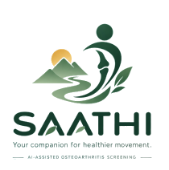
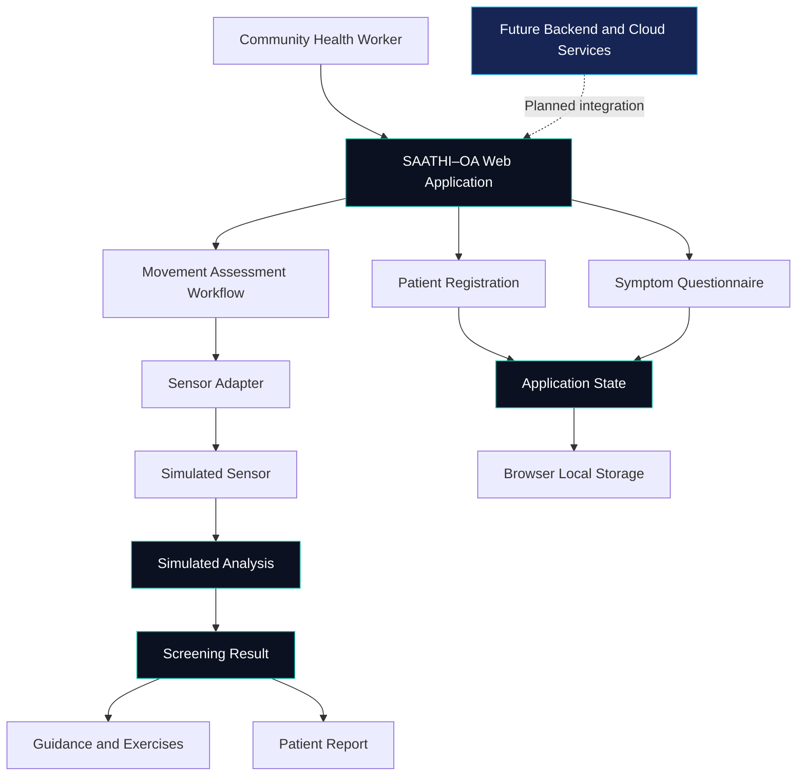
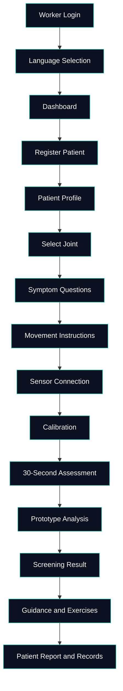

<div align="center">



# SAATHI–OA
### A Companion for Earlier Care

**Community-Centered Osteoarthritis Screening Support**

An innovative healthcare technology prototype designed to support community health workers through structured assessments, movement-analysis workflows, and accessible patient guidance.

<br/>


[Explore Repository](https://github.com/saran799/SAATHI-OA) · [Report an Issue](https://github.com/saran799/SAATHI-OA/issues)

</div>

---

## ✦ Table of Contents

- [Overview](#-overview)
- [The Problem](#-the-problem)
- [Our Approach](#-our-approach)
- [System Architecture](#-system-architecture)
- [Assessment Workflow](#-assessment-workflow)
- [Features](#-features)
- [Technology Stack](#-technology-stack)
- [Project Structure](#-project-structure)
- [Getting Started](#-getting-started)
- [Current Implementation Status](#-current-implementation-status)
- [Roadmap](#-roadmap)
- [Clinical Disclaimer](#-clinical-disclaimer)

---

## ✦ Overview

**SAATHI–OA** is a community healthcare screening-support prototype focused on osteoarthritis assessment workflows.

The project explores how a guided digital experience can help community health workers collect patient information, conduct structured symptom assessments, follow movement-assessment instructions, and provide accessible guidance.

The long-term vision is to connect community-level screening workflows with healthcare professionals and primary healthcare facilities.

> **Our vision:** Make early screening support more accessible, structured, and understandable for underserved communities.

## ✦ The Problem

Osteoarthritis can affect mobility, independence, and quality of life. Communities may face barriers to timely assessment and access to appropriate healthcare guidance.

SAATHI–OA explores a digital workflow intended to support:

- Structured patient registration and assessment.
- Guided collection of symptom information.
- Consistent movement-assessment procedures.
- Accessible post-assessment guidance.
- Organized patient records and future healthcare follow-up.

## ✦ Our Approach

SAATHI–OA combines a guided software workflow with a proposed sensor-assisted assessment architecture.

| Component | Purpose |
|---|---|
| Community worker interface | Guide workers through assessment steps |
| Patient management | Register patients and access their profiles |
| Symptom assessment | Collect structured questionnaire responses |
| Sensor integration | Provide an architecture for movement-data collection |
| Screening workflow | Present prototype screening results |
| Guidance and exercises | Display educational guidance and exercise content |
| Records and reports | Organize assessment information |
| Synchronization architecture | Provide a starting point for future data synchronization |

---

## ✦ System Architecture

The following diagram represents the current software architecture and its intended extension points.



**Important:** Sensor interaction, analysis, and synchronization are simulated in the documented prototype. The diagram does not imply that a production backend or cloud service is currently connected.

## ✦ Assessment Workflow



The application also includes demo error-recovery scenarios for selected stages, such as sensor connection failures, calibration failures, interrupted assessments, and analysis failures.

---

## ✦ Features

### Patient and Assessment Management

- Guided patient registration.
- Patient profiles and records.
- Joint selection.
- Structured symptom questionnaires.
- Step-by-step assessment navigation.

### Movement Assessment Workflow

- Sensor connection interface.
- Calibration workflow.
- Timed movement-assessment stage.
- Simulated sensor and analysis services.
- Screening-result presentation.

### Patient Guidance

- Educational guidance after assessment.
- Exercise information.
- Patient reports.
- Organized assessment history.

### Developer and Demo Tools

- Demo login flow.
- Simulated failure scenarios.
- Offline-mode and failed-sync demonstrations.
- Modular services designed for future hardware and backend integration.

---

## ✦ Technology Stack

<div align="center">

| Technology | Role |
|:---|:---|
| React | User interface |
| TypeScript | Application types and logic |
| Vite | Development server and build tooling |
| React Router | Application navigation |
| Zustand | State management |
| Browser Local Storage | Local persistence in the current prototype |
| Lucide React | Interface icons |
| Tailwind CSS v4 | Styling infrastructure |
| Mermaid | Repository documentation diagrams |

</div>

---

## ✦ Project Structure

```text
SAATHI-OA/
├── src/
│   ├── app/
│   │   └── router.tsx
│   ├── components/
│   │   ├── ui/
│   │   └── layout/
│   ├── domain/
│   │   ├── questions
│   │   ├── risk
│   │   ├── guidance
│   │   └── exercises
│   ├── services/
│   │   ├── sensor.ts
│   │   ├── analysis.ts
│   │   ├── sync.ts
│   │   └── mockData.ts
│   ├── store/
│   ├── features/
│   └── assets/
├── package.json
├── vite.config.ts
└── README.md
```

*The tree highlights key modules documented in the project. Consult the repository for the complete current structure.*

### Key extension points

| File | Responsibility |
|---|---|
| `src/services/sensor.ts` | Sensor adapter and simulated sensor |
| `src/services/analysis.ts` | Simulated analysis |
| `src/services/sync.ts` | Simulated synchronization |
| `src/domain/risk.ts` | Prototype risk logic; not clinically validated |
| `src/store/` | Application state management |

---

## ✦ Getting Started

### Prerequisites

- Node.js and npm.
- Git.
- A modern web browser.

### 1. Clone the repository

```bash
git clone https://github.com/saran799/SAATHI-OA.git
cd SAATHI-OA
```

### 2. Install dependencies

```bash
npm install
```

### 3. Start the development server

```bash
npm run dev
```

Open the local URL printed by Vite, typically:

`http://localhost:5173`

### 4. Build for production

```bash
npm run build
```

### 5. Preview the production build

```bash
npm run preview
```

### Demo access

The current documented demo login accepts any Worker ID and any four-digit PIN. This is demo behavior, not production authentication.

---

## ✦ Current Implementation Status

| Capability | Status |
|---|---|
| Guided application interface | Implemented in prototype |
| Patient registration and assessment flow | Implemented in prototype |
| Symptom questionnaire | Implemented in prototype |
| Movement-assessment screens | Implemented in prototype |
| Sensor data collection | Simulated |
| AI analysis | Simulated; not clinically validated |
| Screening risk logic | Prototype; not clinically validated |
| Offline-mode demonstration | Available through demo controls |
| Cloud synchronization | Simulated; no data leaves the device through this sync flow |
| Production backend | Not established by the current documentation |
| Clinical validation | Not established |

---

## ✦ Roadmap

- [ ] Validate assessment workflows with appropriate clinical experts.
- [ ] Integrate and verify supported physical sensors.
- [ ] Develop a secure backend and database.
- [ ] Implement reliable offline data synchronization.
- [ ] Develop community-worker and supervisor dashboards.
- [ ] Establish appropriate privacy and security controls.
- [ ] Conduct usability testing with intended users.
- [ ] Complete the necessary clinical validation and regulatory assessment before any diagnostic claims or clinical deployment.

Roadmap items are intentions, not completed capabilities.

---

## ✦ Clinical Disclaimer

SAATHI–OA is a **prototype screening-support and educational workflow**, not a diagnostic system or a substitute for assessment by a qualified healthcare professional.

The current sensor, analysis, risk-estimation, and synchronization stages include simulated behavior. The prototype has not been established as clinically validated. Its outputs must not be used to diagnose osteoarthritis or make treatment decisions.

Any future real-world deployment requires appropriate clinical validation, privacy and security safeguards, and applicable regulatory review.

---

## ✦ Contributing

Contributions to usability, software architecture, accessibility, documentation, and responsible healthcare technology are welcome.

1. Explore the existing implementation.
2. Open an issue describing your proposed improvement.
3. Create a feature branch for your changes.
4. Test your changes and submit a pull request.

Please avoid including real patient information, credentials, or sensitive health data in issues and commits.

---

<div align="center">

### SAATHI–OA

**Technology with a purpose. Care with a companion.**

[View Repository](https://github.com/saran799/SAATHI-OA) · [Explore Issues](https://github.com/saran799/SAATHI-OA/issues)

<sub>Built as a healthcare technology prototype focused on accessible community screening support.</sub>

</div>
